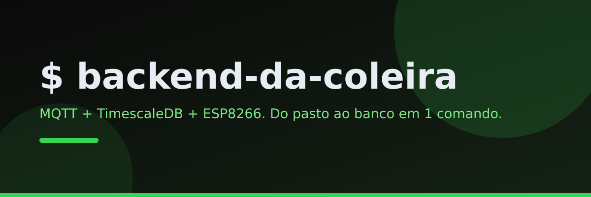

<div align="center">

[](https://github.com/Wagner-Schemmer/rebanho-vivo-backend/stargazers)
[](https://databov-v2.vercel.app)


  <a href="https://databov-v2.vercel.app"></a>

  <h1>Backend da coleira</h1>

  <p>
    <b>MQTT + TimescaleDB + API REST + firmware ESP8266.</b>
    <br />
    Roda no gateway da propriedade (Raspberry Pi, mini-PC ou VPS). Sobe com 1 comando.
  </p>

  <p>
    <a href="https://databov-v2.vercel.app"><b>Site</b></a> ·
    <a href="#o-que-cada-componente-faz">Componentes</a> ·
    <a href="#como-subir">Como subir</a> ·
    <a href="#topicos-mqtt">MQTT</a> ·
    <a href="#firmware">Firmware</a>
  </p>
</div>

```bash
cp .env.example .env   # ajuste DB_PASSWORD
docker compose up -d --build
```

## O que cada componente faz

| Componente | Papel | Como sobe |
|---|---|---|
| **Broker MQTT** | Recebe telemetria das coleiras (`databov/<device>/telemetry`) | ✓ no compose (mosquitto) |
| **TimescaleDB** | Guarda telemetria em hypertable + devices + alerts | ✓ no compose |
| **API REST** | Ingestão, `mag` calculada, agregados de 1 min, regras de alerta (ex.: `WELFARE_LOW`) | ✓ no compose |
| **Firmware ESP8266** | MPU6050 + MAX30102 → MQTT, modo nuvem via Supabase | Arduino IDE / arduino-cli |

## Como subir

1. No gateway: `cp .env.example .env` e ajuste `DB_PASSWORD`.
2. `docker compose up -d --build` e acompanhe com `docker compose logs -f api`.
3. Na coleira: configure `WIFI_SSID`, `WIFI_PASS`, `MQTT_HOST` (IP do gateway) e `COLLAR_ID`, grave e veja os dados chegarem.

## Tópicos MQTT

- `databov/<device>/telemetry` → `{"mag":1.2,"ax":..,"ay":..,"az":..,"gx":..,"gy":..,"gz":..,"batt":3.9,"ts":"2026-.."}`
- `mag` é calculada na API se ausente.
- `databov/<device>/status` → agregado de 1 min da coleira v2 (odba, bem_estar, hr_max, spo2…); cria o device sozinho e gera alerta `WELFARE_LOW` se índice ≤ 2 (máx 1/h por animal).

## REST

- `GET /api/health`
- `GET /api/devices` (com último status)
- `GET /api/devices/:id/telemetry?from=&to=&limit=`
- `GET /api/alerts?open=1` · `POST /api/alerts/:id/ack`

## Firmware

Abra `firmware/coleira/coleira.ino` no Arduino IDE, instale e grave no Wemos D1 Mini. Fiação no topo do arquivo.
Bibliotecas: **SparkFun MAX3010x** + **PubSubClient** (Library Manager).
Compile verificado com arduino-cli (ESP8266 core 3.1.2, RAM 55%, flash 25%).
Fiação: MPU `3V3/VCC G/GND D1/SCL D2/SDA AD0/GND` · MAX30102 `3V3/VIN G/GND D1/SCL D2/SDA` · PulseSensor opcional `3V3/VCC G/GND A0/S` (`USE_PULSE=1`).
Configure `WIFI_SSID`, `WIFI_PASS`, `MQTT_HOST` (broker) e `COLLAR_ID` no topo. Para MQTT local: `docker compose up -d --build` e aponte o MQTT_HOST ao IP do gateway.

## Estrutura

```
databov-backend/
├── docker-compose.yml   # mosquitto + timescaledb + api
├── mosquitto/           # config do broker
├── db/init.sql          # devices, telemetry (hypertable), alerts
├── api/                 # ingestão MQTT + REST + regras de alerta v1
└── firmware/coleira/    # ESP8266 + MPU6050 -> MQTT
```

## Próximos passos (roadmap)

- Trocar regra de limiar por Random Forest treinado com dados rotulados
- RTLS via beacons BLE (confinamento) em vez de GPS
- Rádio BLE final no lugar do Wi-Fi

## Stack

Docker Compose · Mosquitto (MQTT) · TimescaleDB · Node.js (API) · Arduino (ESP8266).

## Quem faz

<a href="https://github.com/Wagner-Schemmer/rebanho-vivo-backend/graphs/contributors"></a>

## Star history

<a href="https://www.star-history.com/#Wagner-Schemmer/rebanho-vivo-backend&Date"></a>

---
Feito por [Wagner Schemmer](https://wagner-port.vercel.app) · [Portfólio](https://wagner-port.vercel.app) · [LinkedIn](https://www.linkedin.com/in/wagner-schemmer-martins-46950627a)
